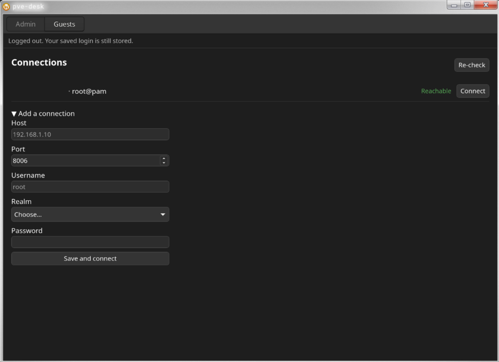
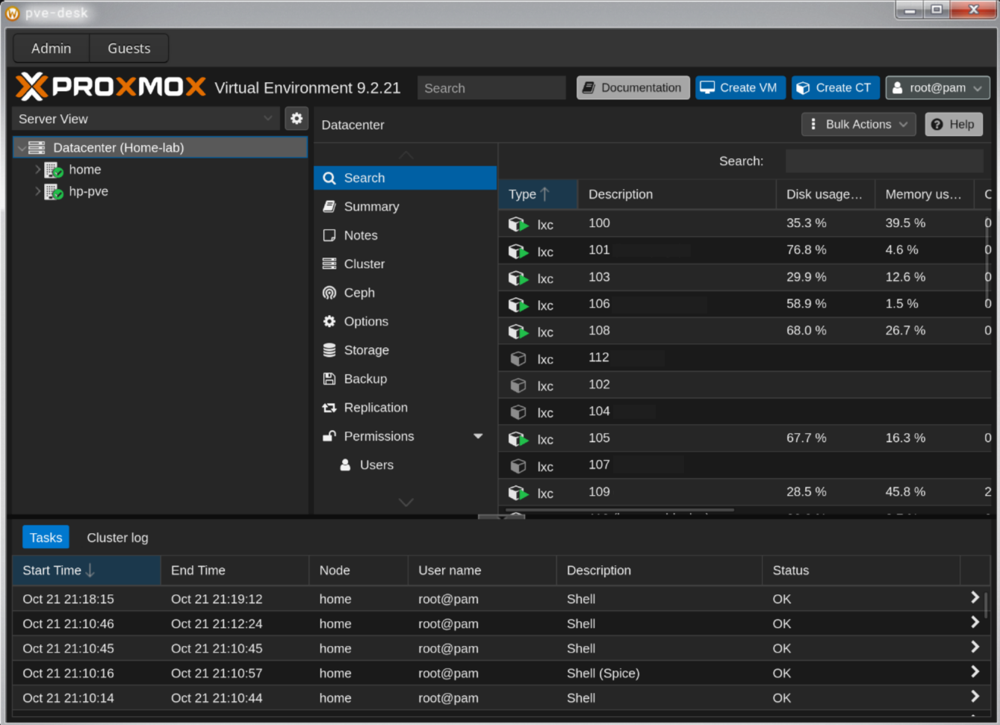

# pve-desk

[](https://github.com/AdamBougher/pve-desk/actions/workflows/ci.yml)
[](https://github.com/AdamBougher/pve-desk/releases)
[](LICENSE)


A Linux desktop client for [Proxmox VE](https://www.proxmox.com/en/proxmox-virtual-environment/overview),
written in Rust with [Tauri 2](https://v2.tauri.app/). It saves your logins,
opens the Proxmox web UI already signed in, and lists your VMs and containers
alongside it — one window, no login form, no browser tab.

> Most of the code here was written by an AI model under my direction.
> See [AI assistance](#ai-assistance) before you point it at a server.

## Screenshots





<!-- Save the two PNGs as docs/screenshots/launcher.png and admin.png, then
     delete the line above and uncomment this table.

| Launcher | Admin panel |
| --- | --- |
|  |  |
-->

## Why

I wanted my Proxmox admin GUI as a desktop app. I used to use Sakakun's
[Proxmox-Desktop-Client](https://github.com/sakakun/Proxmox-Desktop-Client) on
Windows and wanted the same experience on Linux, so I built one.

## Features

- **Connection launcher.** The app opens on your saved connections. Each one
  shows whether the node is reachable and whether its session is still valid.
  The reachability check sends no credentials.
- **Saved logins.** Your password goes to the system keyring. Host, port,
  username and realm go to a plain config file. Several connections can be
  saved; one is signed in at a time.
- **One window, two tabs.** An **Admin** / **Guests** strip switches between
  the Proxmox web UI and the guest list. Admin is greyed out until you
  connect.
- **Embedded admin panel, already signed in.** The full Proxmox web UI with
  no login form — the app injects the session ticket as a cookie before the
  page loads. Opens automatically on connect.
- **Consoles work.** Node shells and VM/container consoles run inside the
  panel.
- **Guest list.** A read-only summary of every VM and container — status,
  node, VMID, tags — refreshed every 30 seconds, with a search box over name,
  VMID, node and tag. Templates are hidden.
- **Certificate verification that survives renewal.** The node must either
  validate against your OS trust store *or* match the SHA-256 fingerprint you
  confirmed when you first set the connection up. So a real certificate
  (Let's Encrypt, Tailscale, your own CA) just works, while Proxmox's
  self-signed default is pinned. An unknown certificate stops the connection
  and shows you the fingerprint before anything is sent. The admin panel's
  webview pins the same fingerprint.
- **Session refresh.** Proxmox tickets last about two hours. A session older
  than ~90 minutes is renewed before the next call, and a ticket the node
  rejects anyway triggers one silent re-login and a retry. If that fails too,
  you land back on the launcher with the reason.
- **Log out.** Drops the session, keeps the saved credentials.

## What isn't done

Honest limits, so you can judge it before installing:

- **SPICE consoles don't have a button.** The `.vv` file handling is written
  and hardened (mode 0600, one file per launch, deleted seconds after the
  viewer starts), but `remote-viewer` isn't installed on my machine, so it has
  never actually run. Use the in-panel consoles instead.
- **You can't delete a saved connection** from the launcher yet. It means
  destroying a keyring entry, and I haven't decided how that should behave.
- **No native power buttons.** Start/stop/shutdown live in the embedded admin
  panel, which does it better than I would. The backend code is still there.
- **Linux only, in practice.** Windows and macOS compile — Windows is built in
  CI — but neither has ever been run, and where the UI can't be shared, Linux
  wins: the tab strip is a GTK widget, so elsewhere the admin panel would be a
  separate window.
- **A few paths are unproven**, including the real 90-minute ticket refresh
  (only tested with the threshold lowered to seconds) and running two saved
  connections side by side.

[ROADMAP.md](ROADMAP.md) keeps the full "Known gaps" list; treat it as the
boundary of what works.

## Requirements

On the Proxmox side:

- A Proxmox VE node reachable over HTTPS.
- An account that signs in with **a single factor** — the app fetches a ticket
  from `/api2/json/access/ticket` and has no interactive TOTP prompt.
- Permissions: `VM.Audit` to list guests, `VM.PowerMgmt` for power actions,
  `VM.Console` for SPICE. A read-only account with `VM.Audit` is enough for
  the guest list.

On your desktop:

- A **Secret Service** keyring running — GNOME Keyring, KWallet, or KeePassXC
  with Secret Service enabled. Without one, the password can't be stored and
  saved logins won't work.
- `virt-viewer`, only if you want SPICE.

## Install

### AppImage

Grab it from the [latest release](https://github.com/AdamBougher/pve-desk/releases/latest):

```sh
chmod +x pve-desk_1.0.0_amd64.AppImage
sha256sum -c pve-desk_1.0.0_amd64.AppImage.sha256
./pve-desk_1.0.0_amd64.AppImage
```

Built by CI on Ubuntu 22.04, so it expects glibc 2.35 or newer. I run the app
from source day to day, so if the AppImage misbehaves on your distro, open an
issue — that's the build I have the least mileage on.

### Arch / CachyOS

```sh
git clone https://github.com/AdamBougher/pve-desk.git
cd pve-desk/packaging/arch
makepkg -si
```

Not on the AUR yet.

## Building from source

Install your distro's dependencies:

```sh
# Arch / CachyOS
sudo pacman -S webkit2gtk-4.1 libsoup3 librsvg virt-viewer base-devel

# Debian / Ubuntu
sudo apt install libwebkit2gtk-4.1-dev libsoup-3.0-dev librsvg2-dev \
    build-essential pkg-config virt-viewer

# Fedora
sudo dnf install webkit2gtk4.1-devel libsoup3-devel librsvg2-devel \
    gcc gcc-c++ make pkgconf-pkg-config virt-viewer
```

Then build and run:

```sh
cd src-tauri
cargo run
```

Rust comes from [rustup](https://rustup.rs); `rust-toolchain.toml` pins the
version, so cargo fetches the right one on the first build. The frontend is
plain HTML/CSS/JS with no build step — there is no Node, no bundler and no
framework to install.

To build the AppImage yourself:

```sh
cargo install tauri-cli --version "^2"
cd src-tauri && cargo tauri build
```

## First run

1. **Add a connection** — host, port (8006), username, realm (`pam` or `pve`),
   password. The password goes straight to the keyring.
2. **Confirm the certificate.** If your node uses Proxmox's self-signed
   default, the app shows you its SHA-256 fingerprint and refuses to continue
   until you accept it. Check it against the node first:
   `openssl x509 -in /etc/pve/local/pve-ssl.pem -noout -fingerprint -sha256`.
   Once accepted, it's pinned in your config.
3. **Connect.** The admin panel opens signed in. Switch to **Guests** for the
   VM and container list.

## How your credentials are handled

This is a password-handling app written largely by a language model, so the
rules it was held to are worth stating plainly:

- The password goes to the system keyring and into the login request. Never to
  disk, never to the config file, never to a log line, never into an error
  message.
- TLS verification is never disabled. There is no `danger_accept_invalid_certs`
  anywhere in the codebase, and an unknown certificate aborts the connection
  rather than being accepted silently.
- The frontend cannot ask the backend to call arbitrary API paths. Power
  actions go through an allow-list in the Rust side.
- Server-provided text (VM names, node names, tags, error strings) is rendered
  with `textContent`, never `innerHTML`.
- The admin panel's webview loads a remote site and is given no access to the
  app's own commands.

If you only read one part of this code before trusting it, read
`src-tauri/src/api.rs` (the certificate verifier) and
`src-tauri/src/secrets.rs` (the keyring).

## Where things are stored

| What                                                        | Where                                                                   |
| ----------------------------------------------------------- | ----------------------------------------------------------------------- |
| Settings — host, port, username, realm, pinned fingerprint | `~/.config/pve-desk/config.toml`                                      |
| Password                                                    | System keyring, service `pve-desk`, one entry per `user@realm@host` |

The config file never contains the password.

## Troubleshooting

**The app dies on startup with `Error 71 (Protocol error)`, or consoles render
badly.** WebKitGTK's dmabuf renderer allocates GBM buffers, which fails on the
NVIDIA proprietary driver under Wayland. pve-desk therefore sets
`WEBKIT_DMABUF_RENDERER_FORCE_SHM=1` by default, keeping accelerated
compositing but routing buffers through shared memory. If your GPU wants
something else:

```sh
PVE_DESK_RENDER=legacy pve-desk   # disable the dmabuf renderer entirely
PVE_DESK_RENDER=raw pve-desk      # stock WebKit, no workaround
```

Linux-only; no effect elsewhere.

**Saved logins don't stick.** No Secret Service keyring is running, or it's
locked. There is no password-prompt fallback yet.

**The connection is refused after a certificate renewal.** If your node is on
a pinned self-signed certificate, renewing it changes the fingerprint; the app
will show you the new one to confirm.

## Project documentation

The repo carries its working notes, which is unusual enough to explain:

- [ROADMAP.md](ROADMAP.md) — outstanding work only, plus known gaps. A
  finished feature is deleted from it.
- [DECISIONS.md](DECISIONS.md) — why it's built this way, and what was tried
  and failed. Several ideas in there were built, tested and removed.
- [CLAUDE.md](CLAUDE.md) — the working agreement the AI model operates under,
  including the credential rules above.

```
ui/                       frontend (plain HTML/CSS/JS)
src-tauri/src/commands.rs every function the UI can call
src-tauri/src/api.rs      Proxmox API client + certificate verifier
src-tauri/src/config.rs   ~/.config/pve-desk/config.toml
src-tauri/src/secrets.rs  keyring access
src-tauri/src/spice.rs    .vv file + remote-viewer
packaging/                .desktop entry + Arch PKGBUILD
```

## AI assistance

Most of the code in this repository was written by **Claude Opus 5**, via
Anthropic's Claude Code, working from my direction. I chose the scope, made the
architecture calls, reviewed the output, and ran every test against my own
Proxmox node. The model has never had access to that node or to my
credentials.

- [CLAUDE.md](CLAUDE.md) is the agreement it works under, including the hard
  rules in [How your credentials are handled](#how-your-credentials-are-handled).
- [DECISIONS.md](DECISIONS.md) records what was decided and why, and what was
  abandoned.
- `.claude/skills/` holds the project's own workflow and a Tauri 2 reference,
  so each session works the same way.
- Commits carry a `Co-Authored-By: Claude Opus 5` trailer where the model
  wrote the change.

What that should mean to you, if you are not me: read the code before pointing
it at your own Proxmox server, particularly the parts that touch your password
and TLS. I'd rather you treat the known-gaps list as the honest boundary of
what works than take the feature list on faith.

## Contributing

This is a personal project, built for my own homelab, and that shapes what I
can promise. Bug reports and questions are welcome — if it breaks on your
setup, I want to know. Pull requests are considered, but I may be slow, and I
may say no to anything that widens the scope.

If you do send one, these must pass clean from `src-tauri/`:

```sh
cargo fmt
cargo clippy -- -D warnings
cargo test
```

CI runs the same checks on Linux and Windows. Note that login, the guest list,
the admin panel and SPICE can only be truly verified against a live Proxmox
node — say which parts you actually tested.

## License

[MIT](LICENSE). Do what you like with it; no warranty, which given the
known-gaps list you should take literally.

---

pve-desk is an unofficial, independent project. It is not affiliated with or
endorsed by Proxmox Server Solutions GmbH. "Proxmox" is their trademark.
